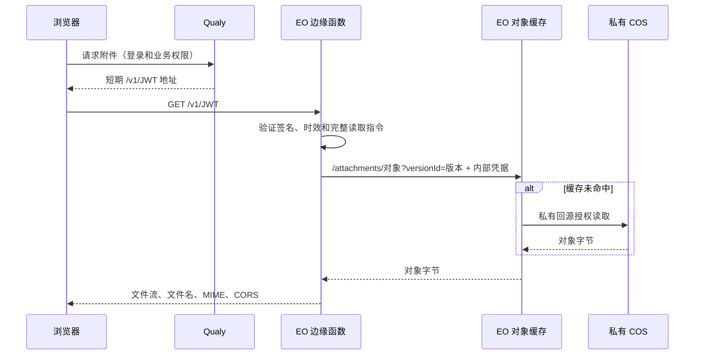

# EdgeOne 附件交付联调记录

2026-10-27 在生产文件域名 `files.qualy.hprogq.cn` 上的实测，以及据此作出的协议决定，对应 storage-cos 的 `edgeone` 交付模式。测试使用生产桶中的临时对象，不读取业务附件。测试对象清理状态见文末。正式 HTTP 联调矩阵从生产服务器发出：本机代理会把该域名解析成 COS 证书，本机测出的结果不可信。

## 协议决定

第一轮联调用的是 EO 原生 D 型 Token（`?token=&t=`）。鉴权本身能工作，但实测暴露出三个无法在函数里解决的问题：

- 原生鉴权在函数之前拒绝请求，403 没有正文，也没有 CORS 头。应用通过 `fetch` 读取 PDF 时，连状态码都拿不到。“自定义错误页面”只作用于回源响应，覆盖不到这一步。
- 链接有效期要在 EO 控制台与服务端两处保持一致。
- D 型密钥在规则编辑器里明文可见。

因此改为 **ES256 签名的 JWT（JWS 紧凑序列化）**，由边缘函数验签，撤掉这个入口上的原生 D 型鉴权：

- 地址形如 `/v1/<JWT>`，不带查询参数。函数拒绝任何查询串。
- 头部固定为 `alg: ES256`、`typ: qualy-download+jwt`，`kid` 只能在函数配置的 JWK Set 里查找。
- 载荷固定为 `iss`、`aud`、`iat`、`exp` 加上 `k`（对象 key）、`r`（版本，`null` 表示读取时不指定版本）、`f`（文件名）、`m`（交付 MIME），成员不能多也不能少。
- 正常签发有效期与验签允许的最大寿命均为 60 秒，容许 3 秒时钟误差。
- 签名私钥只在服务端（`QUALY_STORAGE_COS_EDGEONE_SIGNING_KEY`）；边缘函数只持有公钥（`VERIFY_KEYS`），不能签发凭证。
- 签发和验证共用 `packages/plugins/infra/storage-cos/src/edgeone/protocol.ts`，底层用 jose 实现。边缘函数由 `pnpm qualy cos edge-build` 在安装了开发依赖的源码工作区打包成一个单文件脚本；打包器位于 `src/dev/edge-bundle.ts`，正式服务镜像不包含 esbuild。

## EO 运行时的 WebCrypto

第一次部署 JWT 版本时，所有合法凭证都被拒绝，`x-qualy-detail` 为 `Error: Param Invalid`；同一份 JWK Set 在本地验证通过。用临时探针函数逐项对照后，确认本次所测 EO 网站加速边缘函数运行时的 WebCrypto 有三处与标准不同：

- `importKey('jwk', …)` 对 EC 公钥一律失败，而且是**同步抛出**，不是返回被拒绝的 Promise，链在后面的 `.catch()` 接不住，函数直接返回 545。`spki` 和 `raw` 格式可以导入。
- ECDSA 签名按 **DER** 编码读写：运行时自己签出的 P-256 签名长 70 字节、以 `30 44` 开头。标准和 JWS 用的是 64 字节的 r‖s，所以一个正确的 ES256 签名验出来是 `false`，不会报错。
- 算法参数的 `hash` 只接受字符串；写成 `{ name: 'SHA-256' }` 会报 Param Invalid。

处理方式是保持 jose 作为唯一的 JWT 实现，只在边缘打包里加一层适配（`src/edgeone/webcrypto.ts`）。esbuild 用 `inject` 把它替换为包内所有对全局 `crypto` 的引用，不修改任何全局对象。适配层做三件事：

- EC 公钥 JWK 改为按 `raw`（0x04‖x‖y）导入，在标准运行时上也等价；
- `hash` 统一传字符串；
- 每个实例首次验签时，用固定公开测试向量直接探测 `verify` 接受 P1363 还是 DER，不生成临时密钥。P-256 签名在两条分支前均须为 64 字节；仅在运行时要求时转换成 DER。探测失败归为服务故障，不误报为链接无效。

`tests/edgeone-bundle.test.ts` 用模拟的 EO 运行时跑打包产物：JWK 导入同步抛错，签名和验签走 OpenSSL 的 DER。此前去掉 `inject` 时合法凭证无法验证，与线上现象一致；本轮已将明确的密码运行时故障从 `invalid` 区分为 `unavailable`。

## 内部读取

边缘函数承担文件服务的请求中间件职责：验签、读取对象、投影响应。浏览器不会跳转到内部对象路径，拿到的是函数直接转发的文件流。EO 通过同 Host 子请求提供节点缓存和私有回源能力，因此内部读取仍有一个受保护的 HTTP 地址。

JWT 只有签名，没有加密，持有者可以解码看到对象 key、版本和文件名。对象路径不作为秘密使用；直接请求该路径必须通过独立的内部读取授权。这里选择稳定的 key + versionId 作为缓存地址，使换签名和换文件名不影响对象字节缓存。把真实 key 隐藏起来需要另外引入加密或不透明凭证查表，不属于本次签名交付的保证。

函数读对象时向同一 Host 发出 `/attachments/<key>?versionId=` 子请求。**这个子请求同样会经过规则引擎**，会被“除 `/v1/` 外一律 403”的规则拦下。所以它要带上 `x-qualy-edge-key`，这条 403 规则只放过值与函数 Secret 变量 `QUALY_EDGE_KEY` 完全相等的请求。

这个值是服务间读取凭据：不知道它的人伪造任意值仍然得到 403，但一旦泄露，就能读取规则放行范围内的对象。所以：

- 放行范围要收窄到 `^/attachments/<uuid>/<uuid>$` 且方法为 GET 或 HEAD；
- 回源 COS 之前删除这个头；
- 不要写进日志。

另一个方案是让函数给子请求现签短期凭证（EO 运行时原生支持 MD5 摘要）。它的局限是：D 型签名不覆盖 `versionId` 参数，还需要额外设计路径和版本的保护，所以暂不采用。

## 其他实测结论

- 当前套餐不允许自定义 Cache Key。默认缓存键包含完整查询串，子请求只带 `versionId`，因此不同版本自然分开缓存。同一版本换签名、换文件名访问，`x-qualy-cache` 为 HIT，交付头仍按每次请求单独设置。
- 函数不运行时（把触发路径临时改成不可能匹配的值），`/v1/...` 会回源到 COS 中并不存在的 `v1/<...>` 对象，返回 404 `NoSuchKey`，不会读到任何附件，但会带出 COS 的 XML 错误体。
- 函数的平台默认域名（`*.eo-edgefunctions.com`）也能调用到函数。函数现在只在 `FILES_ORIGIN` 上应答，其他来源一律 404。
- **HEAD 长度的修复已找到并经隔离 EO 探针验证**：`fetch` 返回的 HEAD 响应包含一个空流，保留它构造 `new Response(upstream.body, …)` 可以保留真实长度；将它换成 `null` 则被平台写成 0。2026-10-27 的同源公开图标对照：返回原响应、克隆、替换头后克隆、复用 body 均为 945，`null` 为 0；HEAD → GET → HEAD 两次长度为 945，GET SHA-256 与原图一致。本地修复已保留上游空流，回源方法仍为 HEAD，不读取完整对象，也不伪造 body。正式交付函数尚待本次部署批准后更新，并需以签名附件复验。此前结论只是空 body 构造方式失败，不能据此断言平台无法正确支持 HEAD。
- 函数停用时的热缓存已在本轮**实际操作触发条件**验证，过程见文末。此前仅凭内部路径的热缓存 403 推断已覆盖停用场景，证据不足，现予纠正。
- 生产桶已开启版本控制。生产库里的附件当时全部是 `local` 后端，COS 中没有任何附件。

## 控制台配置（站点 hprogq.cn）

| 项                                              | 内容                                                                                                                                                                           |
| ----------------------------------------------- | ------------------------------------------------------------------------------------------------------------------------------------------------------------------------------ |
| 规则 Qualy files deny outside v1                | Host = files 且路径不匹配 `^/v1/`，并且内部密钥头不等于密钥、路径不是 `^/attachments/<uuid>/<uuid>$`、方法不是 GET/HEAD 三者之一成立时，返回 403（`qualy-files-forbidden` 页） |
| 规则 Qualy files object cache                   | Host = files 且路径匹配 `^/attachments/` 时，节点缓存自定义 1 小时，忽略源站 Cache-Control；回源前删除 `x-qualy-edge-key`                                                      |
| 边缘函数 `qualy-file-delivery`（`ef-3cdjmump`） | 触发条件 Host = files 且路径 `/v1/*`；环境变量 `FILES_ORIGIN`、`APP_ORIGIN`、`ISSUER`、`VERIFY_KEYS`、`QUALY_EDGE_KEY`（Secret）                                               |

files Host 的图片瘦身、格式转换、自动旋转、去 EXIF、指定参数处理全部关闭：原件必须保持原始字节。

## 第一轮实测矩阵（D 型）

| 情况                                             | 结果                                                       |
| ------------------------------------------------ | ---------------------------------------------------------- |
| 指定版本 v1、v2                                  | 200，SHA-256 与写入时一致                                  |
| 不指定版本                                       | 200，最新版本                                              |
| `versionId=null`（对象写于开启版本控制之后）     | 404                                                        |
| 篡改签名、缺签名、过期、篡改描述中的文件名或版本 | 403                                                        |
| 直接访问 `/attachments/...`，或带伪造的密钥头    | 403                                                        |
| 额外的 `versionId`、`eo-img.*` 参数，重复的 `t`  | 403                                                        |
| `Range: bytes=0-99`                              | 206，`Content-Range` 正确；之后再完整 GET，哈希仍正确      |
| 越界 Range                                       | 416                                                        |
| 不存在的对象                                     | 404                                                        |
| `Origin` 为应用自身                              | 返回 ACAO 与 Expose-Headers；其他 Origin 不返回            |
| OPTIONS（应用 / 其他来源）                       | 204 / 403                                                  |
| POST                                             | 405                                                        |
| 同一版本，不同文件名与 MIME                      | 内容相同，`Content-Type` 与 `Content-Disposition` 各自正确 |

D 型 Token 鉴权规则已在改用 JWT 后删除。

## JWT 实测矩阵

下表记录已执行的 JWT 交付检查。HEAD 长度与未执行的边界单独列出，不计入通过结论：

| 情况                                                  | 结果                                                                |
| ----------------------------------------------------- | ------------------------------------------------------------------- |
| 指定版本 v1、v2；不指定版本                           | 200，SHA-256 与写入时一致；不指定版本读到最新版本                   |
| 同一版本换一个新签发的凭证                            | 200，`x-qualy-cache: HIT`                                           |
| 同一版本，不同文件名与 MIME                           | HIT，`Content-Type` 与 `Content-Disposition` 各自正确               |
| `r` 为 `"null"`（对象写于开启版本控制之后）           | 404 `missing`                                                       |
| 篡改签名、换成 DER 形式的同一签名、别的密钥签名       | 403 `invalid`，不回源                                               |
| 过期                                                  | 403 `expired`；带应用 Origin 时有 ACAO，并按语言返回中文正文        |
| 额外查询参数 / 不是凭证                               | 400 `invalid` / 400 `invalid`                                       |
| 直接访问 `/attachments/...`（含伪造密钥头）、其他路径 | 403（规则 02）                                                      |
| `Range: bytes=0-99`；之后完整 GET；多段 Range         | 206 且 `Content-Range` 正确；200 哈希正确；多段返回 416，不读取文件 |
| 越界 Range / 不存在的对象                             | 416 `range` / 404 `missing`                                         |
| 应用 Origin / 其他 Origin                             | 有 ACAO / 没有                                                      |
| OPTIONS（应用 / 其他来源）/ POST                      | 204 / 403 / 405 带 `Allow`                                          |
| 函数的平台默认域名                                    | 404 `not_found`                                                     |

## 审计收尾（2026-10-27）

### 失败响应与配置

错误正文只返回轻量中英文纯文本，不提供 HTML 或 JSON。语言按 `Accept-Language` 权重选择，跳过 `q=0`，无支持项时默认中文。应用内提示由应用的语言设置负责，不解析这些词句。

| 状态                           | 中文正文             |
| ------------------------------ | -------------------- |
| 已验签且过期                   | 下载链接已过期       |
| 格式、签名或声明无效           | 下载链接无效         |
| 有效凭证指向不存在的对象或版本 | 文件不存在           |
| 配置、密码运行时或读取失败     | 下载失败，请稍后重试 |
| 请求方式或范围不支持           | 无法完成下载         |

错误响应统一携带 `no-store`、`nosniff`、实际 `Content-Language`、`Vary: Origin, Accept-Language`；合法应用 Origin 可读取响应和 `X-Qualy-Reason`。公开原因码限定为 `invalid`、`expired`、`missing`、`unavailable`、`range`、`method`、`not_found`、`forbidden`，不公开任意异常消息、验签步骤或上游状态。根路径继续由现有规则返回 `403 Forbidden`，不扩大函数入口。已经开始传输后的流错误无法改写成新的错误响应。

公钥集合初始化检查非空、唯一且非空的 kid、EC/P-256、无私钥字段、用途与操作约束，并实际导入每一把公钥（包括轮换公钥）。初始化失败返回 502。`VERIFY_KEYS` 是公钥，可以保持 string 类型；签名私钥仅在 Qualy 服务端，内部读取凭据 `QUALY_EDGE_KEY` 使用 Secret，三者不能混用。

单字节范围请求转发 `If-Range`；上游忽略条件而返回不匹配的 206 时，取消该响应并重新请求完整表示。HEAD 不转发 Range。真实环境已验证匹配条件得到 206，不匹配得到完整 200，随后完整 GET 哈希正确。

### EO 编辑器诊断

上传的是 esbuild 生成的 JavaScript，TypeScript 源码中的类型已经擦除。编辑器对生成文件重新推断导致 `{}` 上没有 `importKey/verify`、联合类型缺少字段等诊断；其内置声明也没有覆盖部分现代 JavaScript API。生成文件的首行明确使用 `@ts-nocheck`，**只关闭云端对生成物的重复类型推断**，源码不关闭检查，第三方库生成内容不手改。

这不等同于运行时兼容性保证。仓库对源码执行 typecheck，对真实 bundle 分别在标准 WebCrypto 和模拟本次 EO 差异的环境中执行正反例；额外移除可选的 `Uint8Array.fromBase64` / `toBase64` 与 `Error.captureStackTrace`，确认 jose 的回退路径可工作。真实 EO 上再验证合法令牌、篡改、过期及其他拒绝分支。`Object.hasOwn`、`structuredClone` 等必需调用随真实交付与拒绝路径验证，不以编辑器是否画红线推断能力。

### 热缓存下停用函数

经用户明确授权，在站点 `zone-3wo5irgbmg8s` 的 `rule-771xqe4g` 上执行：

1. 用同一临时对象连续读取，确认 200、300000 字节、SHA-256 与上传值一致，且 `x-qualy-cache: HIT`。
2. 保留 Host 条件，将触发路径临时从 `/v1/*` 改成 `/__qualy_disabled_audit__/*`。内部路径拒绝规则保持不变。
3. 首次检查仍得到函数的响应，说明配置尚未下发；该轮不算停用验收。下发后，原先热缓存使用的同一外部 URL、新签发有效 URL、无效凭证 URL 均得到 COS 的 404，未收到附件字节。内部热缓存对象路径和伪造内部密钥请求仍为 403。
4. 恢复原触发路径 `/v1/*`。等待实际请求确认生效后，有效凭证再次得到 200、300000 字节、相同 SHA-256 和 HIT；无效凭证恢复为 400 `invalid`。恢复初期仍为 COS 404 的请求只记录为配置下发过程，不计入恢复通过。

停用后外部路径回落到 COS 的 XML 404，可能包含请求路径，不能将其描述成函数提供的统一错误文案。这里证明的是本次规则组合下，函数未触发时没有通过缓存取得附件；不泛化为任意后续规则配置都安全。

### 验证范围

本轮本地相关测试 112 项通过、27 项真实 COS 集成用例跳过；`mise exec -- pnpm typecheck` 与 `pnpm lint` 通过；本轮涉及目录的 `oxlint --type-aware` 通过。全仓 type-aware lint 另有 4 项失败，均在用户已有的 `tools/benchmarks/ci-browser-run.mjs`、`ci-native-probe.mjs` 排序实验代码中，未改动这些文件。线上矩阵 26 项请求覆盖版本、哈希、热缓存、HEAD 后 GET、Range 后 GET、If-Range、CORS、语言权重、纯文本、根路径和默认函数域名。HEAD 的零长度字段单列为已知限制，不能用矩阵的其他断言通过掩盖它。

历史 `"null"` 版本读取已通过本地签发与回源参数测试；本轮在线仅测试新对象请求 `versionId=null` 返回 404，没有覆盖真实的开启版本控制前历史对象。带压缩元数据的真实 COS 对象未在本轮测试；非 identity 上游响应的拒绝与 body 取消由本地测试覆盖。

### 临时资源清理

本轮临时对象的两个版本已删除，并重新按精确 key 列举确认剩余版本为 0。未读取或删除业务附件；节点缓存仅按本轮对象的无版本地址与两个明确版本地址刷新。控制台历史记录确认三条 URL 刷新均成功（2026-10-27 19:29:07），未刷新整站缓存。

收尾时再次核对控制台：函数列表仅有正式交付函数，没有残留临时探针；其触发条件已恢复为 `files.qualy.hprogq.cn` 的 `/v1/*`，没有保留 `disabled_audit` 路径。

## 服务端直读与应用交付（2026-10-27）

`Storage.read` 保留 `open` 的租户、附件和授权检查，但返回服务端读取流。后端必须在调用方的 Effect Scope 关闭时释放读取资源；即使调用方未开始消费、超时或提前结束，也不能留下网络连接。COS 通过 SDK 的 `getObjectStream` 直接读取指定版本，版本解析与签发端共用 `readRevision`，版本化桶中缺失的历史版本映射为字符串 `"null"`。此操作不调用签名下载入口，也不受 `direct` / `edgeone` 浏览器交付模式影响。

通讯录导入、综测管理导入和 `storage export` 已改为这条读取链路。导入保留 20 秒超时与文件大小上限，并校验实际长度；COS 请求 identity 编码，非完整 200 或非 identity 响应在交付字节前被拒绝。备份逐个文件持有读取 Scope，保留版本、大小与 SHA-256 校验，错误时不将该文件写入完成清单。

附件内容端点与管理导入源文件端点继续执行原有授权。重定向后端返回 `302` 与 `Cache-Control: private, no-store`；本地后端继续流式返回。下载按钮始终指向这个内容端点，因此每次点击重新取得当前权限下的短期文件链接，文件正文仍由文件服务交付。

实际 Chromium 测试发现，“全部下载”同步点击多个 `download` 链接时，跨域 302 会发生导航竞争：两个内容请求都发出，但只有最后一个文件被保存，增加 `_blank` 也未解决。现为每个文件使用独立、隐藏且只允许下载的沙箱 iframe，避免互相取消；不缓存文件字节、不打开新标签。每个入口仍执行业务鉴权，CSP 的 `frame-src` 仅增补当前配置的文件读取来源。保存的请求列表仅由用户点击改变，后续换一份审核数据不会自动下载新附件。

图片与 PDF 预览失败后最多重新申请一次当前链接，同一附件的并发申请复用进行中的查询；第二次失败保留可见提示。重新授权仍经过业务权限检查。主动关闭再打开预览会开始新的尝试；一次自动刷新不能重置本次失败预算。应用使用自己的本地化提示，不读取边缘内部诊断信息。

### 本地验证及尚未部署的部分

- Node 回归：存储、本地及 COS 驱动、通讯录导入、综测管理导入和附件 HTTP 共 255 项通过；27 项需要真实 COS 凭据的集成用例跳过。
- 真实本地 HTTP + COS SDK 验证指定版本、identity 编码、异常响应拒绝、提前结束、未消费释放、凭据延迟返回后的取消与超时连接关闭。此证据证明 SDK 的流行为，不证明生产网络使用内网链路。
- HTTP 路由测试验证未登录与不可读附件不会签发链接、每次合法请求生成新的 302，以及本地流返回的文件名和原始字节。
- Chromium 中的附件、填报表单与导入页面共 118 项通过；审核工作台补充回归 67 项通过。覆盖 PDF 续签、再次失败不关闭预览、主动重开、图片灯箱恢复、并发缩略图重试及审核布局。
- 独立 Chromium 下载实验实际渲染 `FilingColumn` 并点击“全部下载”：两个本地内容端点要求会话 cookie 后返回跨 origin 的 302，文件服务器通过 `Content-Disposition` 交付。修复后保存 `proof-a.txt` 与 `证明-b.txt`，字节分别为 `attachment-a` 与 `attachment-b`，两个内容请求、两个文件请求且仍只有一个页面。开启正常弹窗拦截及限制读取来源的 `frame-src`；这项证明浏览器的重定向与保存行为，不代替生产 EO 端到端验收。

Effect 的作用域与中断行为依据当前 catalog 对应的 `repos/effect/packages/effect/src/Effect.ts` 中 `acquireRelease`、`timeoutOrElse`，并由实际 SDK 连接关闭测试核对。延迟授权测试等待底层请求的 `abort` 事件，不能把连接尚未建立时的零计数算作释放成功。

`mise exec -- pnpm typecheck`、本轮改动范围的 `oxlint --type-aware --report-unused-disable-directives-severity=error`、格式化与 `git diff --check` 通过。上述 Node、浏览器和控制台证据分别记录，不把本地通过等同于生产已部署。

这部分尚未发布到 Qualy 生产应用，也未切换生产环境变量。生产服务器到 COS 的内网读取、真实业务页面跨 EO 下载与 COS 自定义域名清理仍需在上线阶段分别核验。`qualy cos edge-deploy` 尚未实现，当前只提供构建与生成签名密钥命令，边缘发布仍通过控制台操作。
